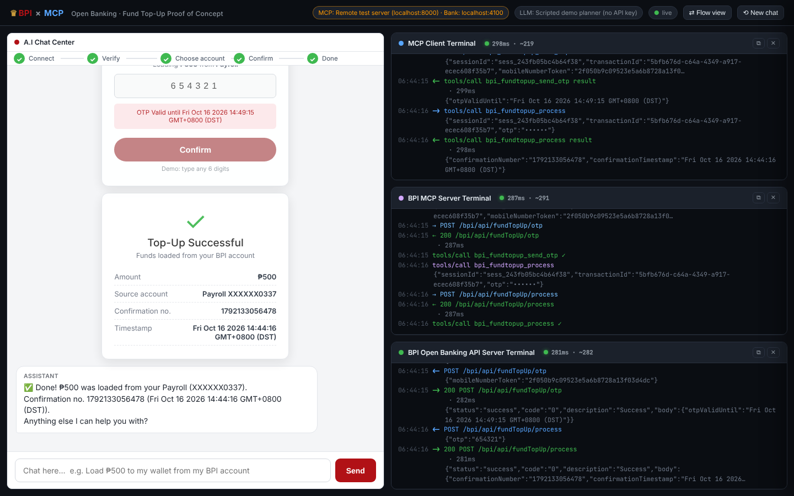

# Deploy the BPI MCP Server to AWS (Amazon Bedrock AgentCore Runtime)

**Start here.** This folder puts the proof of concept's **BPI MCP Server** on
AWS, so partners can reach it over the internet, with no laptop or Codespace
running it.

* The **demo** you know keeps working **exactly the same**: same partners, same
  accounts, same screens, same terminal panels.
* The same code can grow into **production** by switching a settings file. It
  doesn't need to be rewritten.
* Your **local proof of concept is untouched**. `npm start` behaves as before
  until you choose otherwise.

> New to AWS? Read **[docs/1-concepts.md](docs/1-concepts.md)** first (10 minutes).
> It explains every AWS word used here in plain language.

---

## The idea in one picture

The demo UI can run in two modes. You pick one with **one setting** in `.env`:

```
MCP_MODE=local   (default — exactly today's proof of concept)

   Demo UI ──► BPI MCP Server ──► Mock bank
   (all three on your machine / Codespace)


MCP_MODE=aws     (after you deploy with this folder)

   Demo UI ──────► BPI MCP Server ─────────► Mock bank
   (Codespace)     on Amazon Bedrock         on Amazon Lightsail
                   AgentCore Runtime         (demo only)
       │           (Singapore)                    ▲
       └──── customer login screens ──────────────┘
```

**Why does the bank also go to AWS?** In OAuth, the customer logs in at the bank,
and then the MCP server exchanges that login for a token at the bank. Both have
to talk to the **same** bank, just like the real BPI is one public website. In
production you delete the mock bank and point to the real BPI API.

**Which code runs on AWS?** The very same `server/bpi-mcp-server.js` that the
local PoC runs. This folder only adds a small "HTTP plug" around it
(`src/http-server.js`), because AgentCore talks to MCP servers over HTTPS
instead of stdio.


*The demo UI in `MCP_MODE=aws`. This image was taken during a local test run of
the AWS setup, so the orange badge says "Remote test server". On AWS it reads
**"MCP: AWS AgentCore (ap-southeast-1) · Bank: Lightsail mock"**. All four
panels fill exactly as they do locally.*

---

## Before you start

| You need | Why | How to check |
|---|---|---|
| An **AWS account** you are allowed to create things in | Everything is created there | You can sign in to https://console.aws.amazon.com |
| **GitHub Codespaces** (or any Linux/Mac terminal) | To run the scripts | You are reading this in your repository |
| **About 45 minutes** the first time | Some AWS steps take a few minutes each | — |
| **AWS CLI v2**, **Docker**, **Node.js 22**, **zip**, **lightsailctl** | Tools the scripts use | `./scripts/00-check-tools.sh` checks everything and tells you how to fix anything missing |

Region: everything goes to **Asia Pacific (Singapore), `ap-southeast-1`**.

---

## The steps at a glance

Run them **in order** from this folder (`cd deploy/aws-agentcore`). Each script
explains what it is doing, shows ✅ when a step succeeds, and tells you where to
look in the AWS console. Each one is safe to run again.

| # | Script | What it does | Time |
|---|---|---|---|
| 0 | `./scripts/00-check-tools.sh` | Checks your tools and AWS login. Creates nothing. | 1 min |
| 1 | `./scripts/01-deploy-mock-bank.sh` | Puts the **mock bank** on Amazon Lightsail | 5–10 min |
| 2 | `./scripts/02-upload-mcp-server.sh` | Packs the **MCP server** code into a zip and uploads it | 1–2 min |
| 3 | `./scripts/03-create-permissions.sh` | Creates the **IAM role** the server runs as | 1 min |
| 4 | `./scripts/04-create-partner-logins.sh` | Creates **partner logins** in Amazon Cognito (DRAGONPAY, JUANPAY) | 1–2 min |
| 5 | `./scripts/05-create-agentcore-runtime.sh` | Starts the **MCP server on AgentCore** | 2–5 min |
| 6 | `./scripts/06-test-on-aws.sh` | Runs the whole top-up journey against AWS and prints ✅ per step | 1 min |
| 7 | `./scripts/07-write-demo-ui-settings.sh` | Points the **demo UI** at AWS (writes `.env`) | instant |
| 🗑 | `./scripts/99-delete-everything.sh` | Deletes it all, so nothing keeps costing money | 2 min |

```bash
cd deploy/aws-agentcore
npm install                       # first time only
./scripts/00-check-tools.sh       # fix anything it reports, then continue
./scripts/01-deploy-mock-bank.sh
./scripts/02-upload-mcp-server.sh
./scripts/03-create-permissions.sh
./scripts/04-create-partner-logins.sh
./scripts/05-create-agentcore-runtime.sh
./scripts/06-test-on-aws.sh
./scripts/07-write-demo-ui-settings.sh
cd ../.. && npm start             # the demo UI, now using AWS
```

Detailed, step-by-step guides:

1. **[Concepts in plain words](docs/1-concepts.md)**: what AgentCore, Lightsail, Cognito, IAM, etc. are
2. **[Deploy the mock bank to Lightsail](docs/2-deploy-mock-bank-lightsail.md)**: step 1, including the code
3. **[Deploy the MCP server to AgentCore](docs/3-deploy-mcp-server-agentcore.md)**: steps 0 and 2–6
4. **[Connect the demo UI](docs/4-connect-demo-ui.md)**: step 7, and switching between local and AWS
5. **[Go to production](docs/5-go-to-production.md)**: what to change, plus a checklist
6. **[Troubleshooting](docs/6-troubleshooting.md)**: common errors and their fixes
7. **[Costs and clean-up](docs/7-costs-and-cleanup.md)**: what it costs and how to delete it all

---

## Try it on your machine first (no AWS needed)

Want to see the AWS version work before creating anything in the cloud?

```bash
cd deploy/aws-agentcore
npm install
./scripts/try-locally.sh
```

This starts the mock bank and the MCP server exactly the way they run on AWS
(as two separate web services), then runs the full journey test. You should see
10 ✅ steps and *"🎉 All steps passed"*.

---

## Demo vs production: one switch

All settings live in `config/`:

| File | What it is |
|---|---|
| `config/deploy-settings.env` | Names, region, and **`PROFILE=demo`** or **`PROFILE=production`** |
| `config/demo.env` | The demo profile: same values as the local PoC |
| `config/production.example.env` | Production template. Copy it to `production.env` and fill it in |
| `config/partner-registry.example.json` | Template for the production partner list (stored in AWS Secrets Manager) |

| Setting | Demo | Production |
|---|---|---|
| Bank | Mock bank on Lightsail | Real BPI API |
| Partner secrets | Built-in demo values | AWS Secrets Manager |
| Partner front-door login | Cognito (2 demo partners) | Cognito (your real partners) |
| Login sessions | Server memory | DynamoDB database |
| Network | Public | Private (VPC) |
| Activity lines sent back to the UI | On | Off (logs go to CloudWatch) |
| Idle conversation timeout | 1 hour | 15 minutes |

See **[docs/5-go-to-production.md](docs/5-go-to-production.md)**.

---

## What's in this folder

```
deploy/aws-agentcore/
  README.md                    ← you are here
  docs/                        ← the step-by-step guides
  config/                      ← settings (demo / production)
  scripts/                     ← the numbered scripts (+ lib/ helpers)
  src/
    http-server.js             ← the "HTTP plug" AgentCore runs (port 8000, /mcp)
    settings.js                ← reads every setting, with clear error messages
    partner-registry.js        ← partners: built-in demo, or AWS Secrets Manager
    session-store.js           ← sessions: memory, or Amazon DynamoDB
    caller-identity.js         ← production: which partner sent this token?
    mock-bank.js               ← runs the PoC's mock bank on its own (Lightsail)
    test-journey.js            ← end-to-end test used by steps 6 and try-locally
    unit-tests.js              ← offline checks: npm run unit-tests
  Dockerfile.mock-bank         ← packages the mock bank for Lightsail
  Dockerfile                   ← optional: MCP server as a container (DEPLOY_METHOD=container)
  package.json                 ← this folder's own libraries (the PoC's are untouched)
```

Generated while you deploy, and **never committed** (it's git-ignored):
`.state/outputs.env` holds IDs and the Cognito partner secrets, so **treat it like a
password**. `.state/payloads/` holds the exact requests sent to AWS. `.build/` holds
the zip.

---

## Honest status

* ✅ Tested end to end **locally**: the AWS-style setup runs the full journey with
  the same demo values. The packaged zip runs on its own. The demo UI shows the
  same chat, steps, flow diagram and terminal lines as the local PoC.
* ✅ Every AWS request the scripts send was **checked against AWS's official API
  definitions**, and all scripts were run end to end against a simulated AWS.
* ⚠️ The scripts haven't yet been run in a **real** AWS account. AgentCore is a
  young service, so the first real run may hit a small difference (for example, a
  renamed option). If a script stops with ❌, copy the message. Most cases are
  covered in [docs/6-troubleshooting.md](docs/6-troubleshooting.md).
